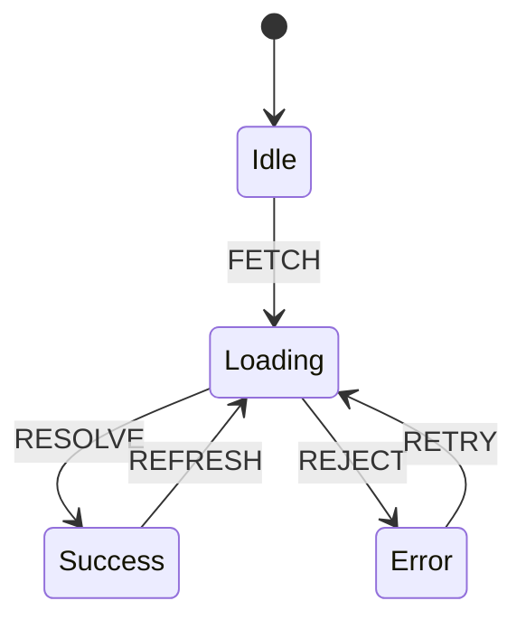

# State machine patterns and search recipes

Use the search recipes in Phase 1, and the per-language patterns when you choose a fix in Phase 3. Each pattern shows the **honest type** (option 2) and, where it helps, the **central transition function** (option 3).

## Contents

1. Search recipes
2. TypeScript and React
3. Python
4. Rust
5. Go
6. Kotlin and Swift
7. SQL and persisted state
8. Diagram template

## 1. Search recipes

Run them from the repo root with ripgrep. They over-match on purpose; you are building a candidate list, not a verdict.

```bash
# Boolean clusters (JS/TS/Java/Kotlin/Swift/C#)
rg -n --no-heading '\b(is|has|was|did|should)(Loading|Fetching|Error|Success|Submitting|Saving|Pending|Retrying|Connected|Connecting|Open|Ready|Done|Busy)\b'

# Python and Ruby style flags
rg -n --no-heading '\b(is|has|was)_(loading|fetching|error|success|submitting|pending|retrying|connected|ready|done|busy)\b'

# Stringly typed status comparisons
rg -n --no-heading -i '\b(status|state|phase|step|stage|mode)\b\s*(===?|!==?|==|!=)\s*["\x27]'
rg -n --no-heading -i '\.(status|state|phase|step)\s*=\s*["\x27]'

# Nullable error fields next to data (TS/JS types and values, Python None, Go nil)
rg -n --no-heading '\b(error|err)\??\s*(:\s*\w+\s*\|\s*(null|undefined)\b|[:=]\s*(null|None|nil)\b)'

# Check-and-set guards (likely races)
rg -n --no-heading -A2 'if\s*\(\s*!\s*(this\.)?\w*(ing|Pending|Busy)\b'

# Timers, retries, polling
rg -n --no-heading -e 'setTimeout|setInterval|retry|backoff|attempts?\b|poll'

# Persisted status columns
rg -n --no-heading -i 'status\s+(varchar|text|enum|int)|CHECK\s*\(\s*status'

# Code that admits impossible states
rg -n --no-heading -i "should never|shouldn.t happen|can.t happen|impossible|unreachable|TODO.*race"
```

Then read each hit's surroundings. A machine is confirmed when you can name its states and the events that move between them.

## 2. TypeScript and React

**Before**: four booleans, sixteen representable combinations, four intended.

```ts
type State = { isLoading: boolean; isError: boolean; data?: User; error?: Error };
```

**After**: each state carries exactly its own data.

```ts
type FetchState =
  | { status: "idle" }
  | { status: "loading" }
  | { status: "success"; data: User }
  | { status: "error"; error: Error };

type FetchEvent =
  | { type: "FETCH" }
  | { type: "RESOLVE"; data: User }
  | { type: "REJECT"; error: Error };

export function transition(state: FetchState, event: FetchEvent): FetchState {
  switch (state.status) {
    case "idle":
    case "success":
    case "error":
      return event.type === "FETCH" ? { status: "loading" } : state;
    case "loading":
      if (event.type === "RESOLVE") return { status: "success", data: event.data };
      if (event.type === "REJECT") return { status: "error", error: event.error };
      return state; // a second FETCH while loading is ignored: no double submit
    default:
      return assertNever(state);
  }
}

export function assertNever(value: never): never {
  throw new Error(`Unhandled state: ${JSON.stringify(value)}`);
}
```

**React**: drive the component with the same function, so UI and logic share one source of truth.

```tsx
const [state, send] = useReducer(transition, { status: "idle" });

switch (state.status) {
  case "idle":    return <Button onClick={() => send({ type: "FETCH" })}>Load</Button>;
  case "loading": return <Spinner />;
  case "success": return <Profile user={state.data} />;
  case "error":   return <ErrorPanel error={state.error} onRetry={() => send({ type: "FETCH" })} />;
}
```

**Stale responses**: when a slow response can arrive after a newer request, tag requests and drop late ones.

```ts
| { status: "loading"; requestId: number }
// RESOLVE carries requestId; ignore it unless it matches the current one
```

**Migration shim**: keep old call sites compiling while you move them over one at a time.

```ts
export const isLoading = (s: FetchState) => s.status === "loading";
export const isError = (s: FetchState) => s.status === "error";
```

## 3. Python

```python
from dataclasses import dataclass
from typing import assert_never  # Python 3.11+

@dataclass(frozen=True)
class Idle: ...

@dataclass(frozen=True)
class Loading: ...

@dataclass(frozen=True)
class Loaded:
    data: "User"

@dataclass(frozen=True)
class Failed:
    error: Exception

FetchState = Idle | Loading | Loaded | Failed

def describe(state: FetchState) -> str:
    match state:
        case Idle():
            return "Press load"
        case Loading():
            return "Loading..."
        case Loaded(data=user):
            return f"Hello {user.name}"
        case Failed(error=err):
            return f"Failed: {err}. Retry?"
        case _:
            assert_never(state)
```

For simple lifecycles stored in a database, a `StrEnum` plus an explicit transition table is enough:

```python
from enum import StrEnum

class OrderStatus(StrEnum):
    PENDING = "pending"
    PAID = "paid"
    SHIPPED = "shipped"
    CANCELLED = "cancelled"

ALLOWED = {
    OrderStatus.PENDING: {OrderStatus.PAID, OrderStatus.CANCELLED},
    OrderStatus.PAID: {OrderStatus.SHIPPED, OrderStatus.CANCELLED},
}

def transition(current: OrderStatus, nxt: OrderStatus) -> OrderStatus:
    if nxt not in ALLOWED.get(current, set()):
        raise ValueError(f"Illegal transition {current} -> {nxt}")
    return nxt
```

## 4. Rust

Rust enums are state machines already; the work is usually replacing parallel `bool` and `Option` fields with one enum.

```rust
enum Connection {
    Disconnected,
    Connecting { attempt: u32 },
    Connected { session: Session },
    Backoff { attempt: u32, retry_at: Instant },
}

impl Connection {
    fn on_event(self, event: Event) -> Connection {
        use Connection::*;
        match (self, event) {
            (Disconnected, Event::Connect) => Connecting { attempt: 1 },
            (Connecting { .. }, Event::Opened(session)) => Connected { session },
            (Connecting { attempt }, Event::Failed) => Backoff { attempt, retry_at: backoff(attempt) },
            (Backoff { attempt, .. }, Event::Tick) => Connecting { attempt: attempt + 1 },
            (Connected { .. }, Event::Closed) => Disconnected,
            (state, _) => state, // every other event is deliberately ignored
        }
    }
}
```

## 5. Go

Go has no sum types, so use a typed constant, a transition table, and the `exhaustive` linter (`github.com/nishanths/exhaustive`) to catch missing `switch` cases.

```go
type OrderStatus string

const (
	OrderPending   OrderStatus = "pending"
	OrderPaid      OrderStatus = "paid"
	OrderShipped   OrderStatus = "shipped"
	OrderCancelled OrderStatus = "cancelled"
)

var allowed = map[OrderStatus][]OrderStatus{
	OrderPending: {OrderPaid, OrderCancelled},
	OrderPaid:    {OrderShipped, OrderCancelled},
}

func (o *Order) TransitionTo(next OrderStatus) error {
	for _, s := range allowed[o.Status] {
		if s == next {
			o.Status = next
			return nil
		}
	}
	return fmt.Errorf("order %s: illegal transition %s -> %s", o.ID, o.Status, next)
}
```

## 6. Kotlin and Swift

```kotlin
sealed interface Upload {
    data object Idle : Upload
    data class InProgress(val bytesSent: Long, val total: Long) : Upload
    data class Done(val url: String) : Upload
    data class Failed(val cause: Throwable, val canRetry: Boolean) : Upload
    data object Cancelled : Upload
}
// `when (upload) { ... }` used as an expression must be exhaustive, so the compiler flags missing states.
```

```swift
enum Upload {
    case idle
    case inProgress(sent: Int64, total: Int64)
    case done(URL)
    case failed(Error, canRetry: Bool)
    case cancelled
}
// `switch` over an enum without `default` must be exhaustive.
```

## 7. SQL and persisted state

Persisted machines need the database to refuse illegal states too, because not every writer goes through your code.

```sql
-- Only known states
ALTER TABLE orders ADD CONSTRAINT orders_status_valid
  CHECK (status IN ('pending', 'paid', 'shipped', 'cancelled'));

-- State-dependent invariants: shipped implies paid
ALTER TABLE orders ADD CONSTRAINT orders_shipped_requires_payment
  CHECK (status <> 'shipped' OR paid_at IS NOT NULL);
```

Make transitions atomic with a conditional update. If no row changes, the transition was illegal or lost a race, and the caller must handle that explicitly.

```sql
UPDATE orders
SET status = 'paid', paid_at = now()
WHERE id = $1 AND status = 'pending';
-- rows affected = 0  ->  already paid, cancelled, or a concurrent worker won
```

Changing stored values (renaming `'complete'` to `'shipped'`) is a data migration: it needs a plan, backfill, compatibility for old readers, and the user's approval.

## 8. Diagram template

````markdown

````

Put the diagram next to the code (a comment link or a `README.md` in the module) so humans and agents see it when they open the file.
